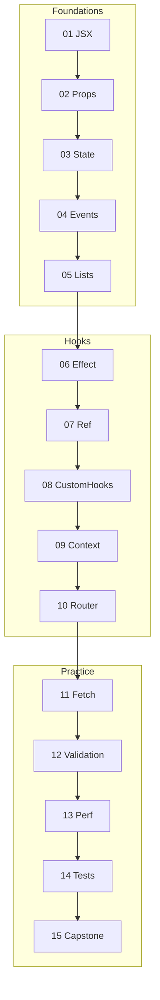

# React Learning Path

A step-by-step React course for [js-playground](../README.md). Each topic is a standalone mini-project: **theory → task → check against `solution/`**.

**Stack:** React 19 · TypeScript · Vite · ESLint

> The AI agent and future lessons follow one style — see [`.cursor/rules/react-lessons.mdc`](../.cursor/rules/react-lessons.mdc)

---

## Prerequisites

- Node.js 20+
- JavaScript ES6+ (modules, arrow functions, destructuring, spread)
- TypeScript basics (interfaces, types)
- HTML/CSS (forms, flexbox)

---

## How to take the course

1. Open the lesson README (`react/NN-topic/README.md`)
2. `cd react/NN-topic && npm i && npm run dev`
3. Complete the task in `src/` — look for `// TODO:`
4. Compare with `solution/` if you're stuck or when you're done
5. Move to the next lesson (when its folder appears)

---

## Lesson structure

```text
react/01-jsx-and-components/
  README.md          # Goal, Theory, Task, Hints (English)
  package.json
  vite.config.ts
  tsconfig.json
  index.html
  eslint.config.js
  src/
    main.tsx
    App.tsx          # starter — work here
    index.css
    components/
  solution/          # full answer — separate runnable project
    package.json
    src/
      ...
```

**Starter** — incomplete code with `// TODO:` markers; must run without errors.  
**Solution** — full working answer; run with `cd solution && npm i && npm run dev`.

---

## Conventions

| Item | Rule |
|------|------|
| Folders | `NN-kebab-case-topic` |
| Language | English (README, TODO, UI copy) |
| Components | `export function Name()` — named exports |
| TypeScript | strict mode |
| UI libraries | none until lesson 15 |
| Markers | `// TODO:` in starter code |

---

## Progress

| # | Lesson | Folder | Status |
|---|--------|--------|--------|
| 01 | JSX & Components | [01-jsx-and-components](./01-jsx-and-components/) | done |
| 02 | Props | [02-props](./02-props/) | done |
| 03 | State (useState) | [03-use-state](./03-use-state/) | done |
| 04 | Events & Forms | [04-events-and-forms](./04-events-and-forms/) | done |
| 05 | Lists & Keys | `05-lists-and-keys` | planned |
| 06 | useEffect | `06-use-effect` | planned |
| 07 | useRef | `07-use-ref` | planned |
| 08 | Custom Hooks | `08-custom-hooks` | planned |
| 09 | Context | `09-context` | planned |
| 10 | React Router | `10-react-router` | planned |
| 11 | Data Fetching | `11-data-fetching` | planned |
| 12 | Forms & Validation | `12-forms-validation` | planned |
| 13 | Performance | `13-performance` | planned |
| 14 | Testing | `14-testing` | planned |
| 15 | Capstone Todo App | `15-capstone-todo` | planned |

---

## Roadmap

### Phase 1 — Foundations

#### 01 — JSX & Components · `01-jsx-and-components` · **done**

**Topics:** JSX syntax, `{}` expressions, attributes, self-closing tags, function components, import/export, Fragment

**Task:** Build a landing page with `Header`, `Main`, `Footer` components and render a tech stack list from an array.

**Docs:** [Writing Markup with JSX](https://react.dev/learn/writing-markup-with-jsx) · [Your First Component](https://react.dev/learn/your-first-component)

---

#### 02 — Props · `02-props` · **done**

**Topics:** passing data parent → child, read-only props, TypeScript `interface Props`, optional props, `children`

**Task:** Build typed `Card`, `UserBadge`, and `Avatar` components.

**Docs:** [Passing Props to a Component](https://react.dev/learn/passing-props-to-a-component)

---

#### 03 — State (useState) · [03-use-state](./03-use-state/) · **done**

**Topics:** local state, setter, re-render, immutability when updating objects and arrays

**Task:** Counter with increment/decrement/reset + light/dark theme toggle.

**Docs:** [State: A Component's Memory](https://react.dev/learn/state-a-components-memory)

---

#### 04 — Events & Forms · [04-events-and-forms](./04-events-and-forms/) · **done**

**Topics:** synthetic events, `onClick`, `onChange`, `onSubmit`, controlled inputs, `preventDefault`

**Task:** Registration form with live preview of entered values.

**Docs:** [Responding to Events](https://react.dev/learn/responding-to-events) · [Reacting to Input with State](https://react.dev/learn/reacting-to-input-with-state)

---

#### 05 — Lists & Keys · `05-lists-and-keys` · planned

**Topics:** `.map()`, `key` prop, conditional rendering (`&&`, ternary)

**Task:** Todo list with all / active / done filter.

**Docs:** [Rendering Lists](https://react.dev/learn/rendering-lists) · [Conditional Rendering](https://react.dev/learn/conditional-rendering)

---

### Phase 2 — Hooks & Architecture

#### 06 — useEffect · `06-use-effect` · planned

**Topics:** side effects, dependency array, cleanup function

**Task:** Timer, update `document.title`, mock API fetch with `setTimeout`.

**Docs:** [Synchronizing with Effects](https://react.dev/learn/synchronizing-with-effects)

---

#### 07 — useRef · `07-use-ref` · planned

**Topics:** DOM refs, storing values without re-render

**Task:** Autofocus input; track previous value with a ref.

**Docs:** [Referencing Values with Refs](https://react.dev/learn/referencing-values-with-refs) · [Manipulating the DOM with Refs](https://react.dev/learn/manipulating-the-dom-with-refs)

---

#### 08 — Custom Hooks · `08-custom-hooks` · planned

**Topics:** extracting logic, `use*` naming convention

**Task:** Implement `useLocalStorage` and `useFetch<T>` hooks.

**Docs:** [Reusing Logic with Custom Hooks](https://react.dev/learn/reusing-logic-with-custom-hooks)

---

#### 09 — Context · `09-context` · planned

**Topics:** `createContext`, Provider, `useContext`, when to use Context vs props

**Task:** ThemeContext consumed by deeply nested components.

**Docs:** [Passing Data Deeply with Context](https://react.dev/learn/passing-data-deeply-with-context)

---

#### 10 — React Router · `10-react-router` · planned

**Topics:** `BrowserRouter`, `Routes`, `Route`, `Link`, `NavLink`, `useParams`, nested routes, 404

**Task:** Home, About, and `User/:id` pages with a 404 route.

**Docs:** [React Router docs](https://reactrouter.com/en/main)

---

### Phase 3 — Production Practice

#### 11 — Data Fetching · `11-data-fetching` · planned

**Topics:** `fetch`, loading / error / empty states, `AbortController`

**Task:** Post list from [JSONPlaceholder](https://jsonplaceholder.typicode.com) with retry button.

**Docs:** [You Might Not Need an Effect](https://react.dev/learn/you-might-not-need-an-effect)

---

#### 12 — Forms & Validation · `12-forms-validation` · planned

**Topics:** inline errors, disable submit, touched fields

**Task:** Form with 3+ fields, inline validation errors, disabled submit until valid.

---

#### 13 — Performance · `13-performance` · planned

**Topics:** `React.memo`, `useMemo`, `useCallback`, when NOT to optimize

**Task:** Heavy list with memoized child; compare re-renders via `console.log`.

**Docs:** [Render and Commit](https://react.dev/learn/render-and-commit) · [memo](https://react.dev/reference/react/memo)

---

#### 14 — Testing · `14-testing` · planned

**Topics:** Vitest + React Testing Library, render, user events, async queries

**Task:** Tests for render, click, form submit, and async behavior.

---

#### 15 — Capstone Todo App · `15-capstone-todo` · planned

**Topics:** combines router, state, fetch/localStorage, forms, tests

**Task:** Full Todo CRUD app — everything from the course in one project.

---

## Dependency graph



---

## Out of scope (for now)

- Next.js, SSR, React Server Components
- Redux / Zustand (optional mention in capstone)
- CSS-in-JS, UI component libraries
